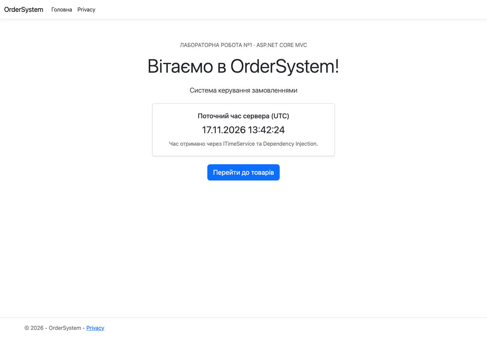

# OrderSystem — лабораторна робота №1

Базовий ASP.NET Core MVC-проєкт, створений командою `dotnet new mvc -n OrderSystem`.

## Запуск

Потрібен .NET SDK 9.0 (перевірено з 9.0.202).

```bash
dotnet --info
cd OrderSystem # якщо ви ще не в папці проєкту
dotnet restore
dotnet build
dotnet run --launch-profile http
```

Відкрити http://localhost:5080. Зупинити сервер: `Ctrl+C`.
Якщо порт зайнятий:

```bash
dotnet run --launch-profile http --urls http://localhost:5081
```

## Реалізація

- `Program.cs`: middleware перед routing виводить метод, шлях та кінцевий HTTP-статус, наприклад `GET / => 200`. Через `OnCompleted` логуються також відповіді після обробки помилок.
- `ITimeService` / `TimeService`: сервіс поточного часу UTC, зареєстрований через `AddScoped` (окремий екземпляр на запит).
- `HomeController.Index`: отримує сервіс через конструктор, передає `HomeViewModel` у Razor view.
- Головна сторінка: привітання, час сервера на момент запиту, посилання `/Products`.
- `/Products`: проста сторінка-заготовка майбутнього каталогу.
- Стандартний `.gitignore` для .NET виключає `bin/`, `obj/`, `.vs/` тощо. Паролі, токени та connection strings не додані.

## Git

`main` містить початковий шаблон і коміт `Init: basic mvc project`.
Гілка `lab01` містить реалізацію лабораторної, документацію та скриншот.

## Перевірка

```bash
curl -i http://localhost:5080/
curl -i http://localhost:5080/Products
curl -i http://localhost:5080/missing
```

Очікуються статуси `200`, `200`, `404`, а в консолі — відповідні middleware-логи.
Час на головній сторінці оновлюється після нового запиту/перезавантаження.

## Скриншот



Опис для PR підготовлено в [docs/PR.md](docs/PR.md).
