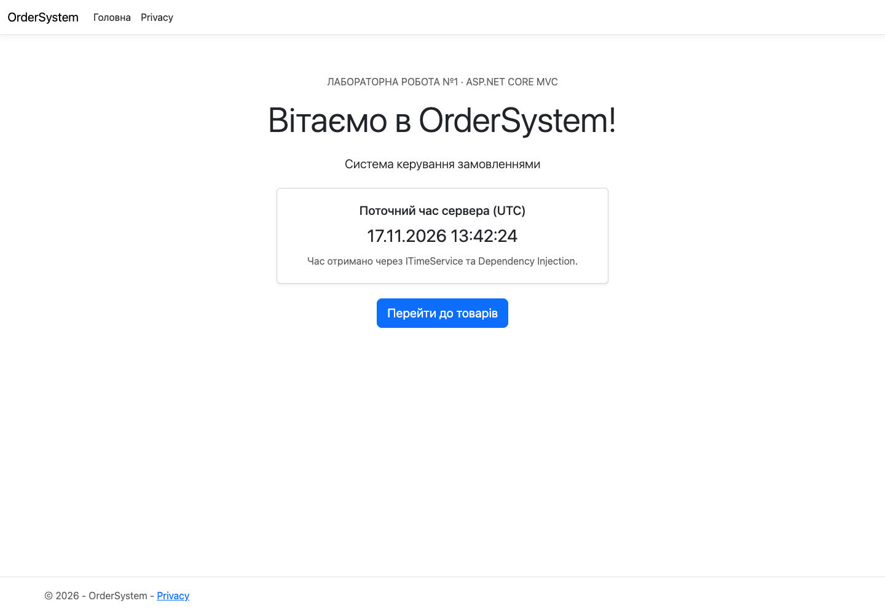

# lab01: create MVC project, add middleware and time service

Створено OrderSystem через `dotnet new mvc`. Додано middleware логування методу, шляху та HTTP-статусу перед routing. `ITimeService` зареєстровано як Scoped; `HomeController.Index` передає час UTC та привітання через модель у view. Головна сторінка містить посилання на `/Products`, для якого додано сторінку-заготовку.

Додано інструкцію запуску, стандартний .NET `.gitignore`, початковий коміт у `main` та реалізацію в `lab01`.

Перевірка: `dotnet build`; запуск через `dotnet run`; HTTP-запити до `/`, `/Products` та неіснуючого маршруту; перевірка middleware-логів.

